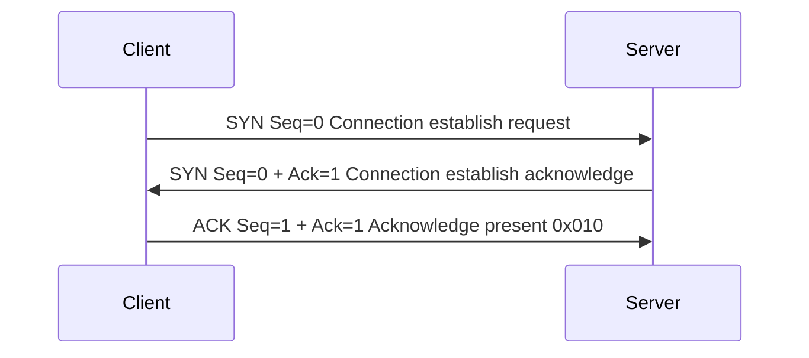

## 4 Lager
1.  Applikationslager:
Sköter SSH HTTP, sköter två ytliga protokoller som användar protokoll och support protokoller
som hanterar vanliga funktioner
2. Transportlager:
Sköter transport genom protokoller som UDP och TCP, TCP är ett säkrare system för mails medans UDP fungerar bättre för streaming och gaming
3.  internetlager:
IP och ICMP jobbar här, internet lager går hela vägen från källa till destination
4.  länklager:
Skapar en frame på lokala nätet för ARP och MAC addresser

## 2 Vilket lager?

| Påstående                                                           | Lager          |
| ------------------------------------------------------------------- | -------------- |
| Bestämmer vilken väg ett paket tar mellan nät                       | Internetlager  |
| Bestämmer vilket program på maskinen paketet ska till            | Transportlager |
| Bestämmer vilken maskin på det lokala nätet paketet ska till     | Länklager      |
| Ansvarar för att data kommer fram i rätt ordning och utan luckor | Transportlager |

## 3 Inkapsling

| HTTP | Baseras på      |
| ---- | --------------- |
| TCP  | portnummer      |
| IP   | IP-addressen    |
| ETH  | MAC addresserna |

## 4 Var byts vad?
*MAC addressen byts ut varje gång den hoppar eller når en t.ex router eller switch. 
*IP addressen byts nästan aldrig då detta är addressen den skickas från och visar destinationen, utan detta förloras paketet.

## 5 Sant eller falskt?
Sant eller falskt? Skriv varför på de falska.
1. TCP kan skicka data snabbare än UDP eftersom det är ett bättre protokoll.
		Falskt, TCP tar sin tid för att säkerställa att alla paket når fram
2. Ett paket kan ha både en MAC-adress och en IP-adress.
		Sant, utan MAC address och en IP address så vet inte routern vem som skickar och den som tar emot, båda är lika viktiga för att utbyte av data kan ske
3. ICMP används för att skicka data mellan program.
		Falskt, ICMP är ett protokoll som skickar paket för nödvändiga funktioner eller rapporter
4. En socket identifieras av en IP-adress och ett portnummer.
		Sant, Utan port nummer vet inte routern vilken applikation som datan skall till som port 22 för SSH, utan IP address finns ingen identitet.

## 6 Handskakningen

## 7 Vilket verktyg

| Fråga                                                | Verktyg | Kommando                                                           |
| ---------------------------------------------------- | ------- | ------------------------------------------------------------------ |
| Vilka portar lyssnar på min maskin just nu?       | ss      | ss -tuln                                                           |
| Vad är IP-adressen till example.org?              | curl    | curl example.com -v                                                |
| Vad skickas på nätet när jag pingar min server?   | tcpdump | sudo timeout 10 tcpdump -nn -v icmp \| timeout 10 ping example.com |
| Vilka tjänster är öppna på en host?               | nmap    | sudo nmap -sS scanme.nmap.org -v                                   |
| Hur ser mina nätverksgränssnitt och rutter ut? | ip      | ip addr && ip route                                                |
## 8 tcpdump rad
port 514 är för system logs
SYN är Början på en anslutning
TCP flaggan S står för SYN, Transportlager
Len=0 menas med att det inte finns extra information i TCP segmentet

## 9 Nycklar

| Begrepp          | Beskrivning                                                             |
| ---------------- | ----------------------------------------------------------------------- |
| Privat nyckel    | 3. Får aldrig lämna din dator                                           |
| B. Publik nyckel | 1. Ligger på servern, i ~/.ssh/authorized_keys                          |
| C. ssh-agent     | 2. Mellanlagrar din upplåsta nyckel så du slipper skriva lösenfrasen |
| D. Jump-server   | 4. Används när målmaskinen inte går att nå direkt                    |

## 10 Varför?
Varför är det farligare att kopiera sin privata nyckel till en server än att kopiera sin
publika nyckel dit?

När man kopierar sin egna nyckel till en server kan denna kommas åt och användas emot dig. Detta låter också andra att låtsas vara du för att komma åt saker som endast du borde haft tillgång till. 

Om någon kommer åt din privata nyckel kan det också betyda att dem kan få åtkomst till din dator via fjärrstyrning utan din vetskapid1{Some text}
